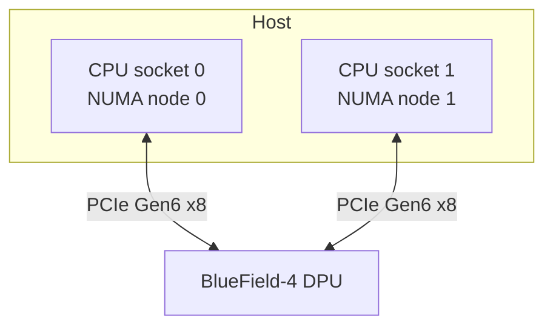

# BlueField-4 Socket Direct considerations

This document describes networking and storage considerations when DPF manages a BlueField-4 DPU in Socket Direct mode.
This configuration is used by platforms such as NVIDIA Vera Rubin.

In Socket Direct mode, the DPU provides a PCIe host interface to each CPU socket in the host.

## Network performance

On Vera Rubin systems, each CPU socket connects to the BlueField-4 DPU through an x8 PCIe Gen6 link.
A workload that uses only one interface is therefore limited to the bandwidth available through that link (800Gbps unidirectional, 400Gbps bidirectional).

> [!NOTE]
> If workloads only sends/recieves traffic (single direction) or do not require more than 400 Gbps in each direction
> or NUMA locality with the DPU host interface, using a single host interface is sufficient.

To make DPU network connectivity available through both PCIe host interfaces, create `DPUServiceInterface` resources
for the required PFs or VFs on each interface and include them in the appropriate `DPUServiceChain`.

Select the host interface with `spec.template.spec.template.spec.<pf|vf>.nicSelector`.
For a BlueField-4 DPU, use `type: dpu` and explicitly set `controllerNumber`:

* `controllerNumber: 1` targets the first host interface (PCIe socket).
* `controllerNumber: 2` targets the second host interface (PCIe socket).

If `nicSelector` is omitted, the SFC controller targets controller number 1.
For configuration examples, see
[DPUServiceInterface API](../developer-guides/api/dpuserviceinterface.md#selecting-nics-on-a-dpu).

> [!NOTE]
> When HBN provides north-south connectivity through both host-facing interfaces, configure either ECMP across both
> interfaces or separate subnets for each interface. With separate subnets, configure host VRFs or equivalent routing
> to preserve traffic symmetry.

To use the aggregate bandwidth of both links:

* Provide network connectivity through PFs or VFs on both host interfaces.
* Distribute workloads across PFs or VFs from both interfaces.
* Place each workload on the NUMA node local to its selected PCIe interface.

NUMA-local placement also avoids traffic crossing the host's inter-socket connection.

## Storage performance with SNAP

The same PCIe and NUMA considerations apply when SNAP exposes remote storage to the host.
To use the aggregate bandwidth of both links, expose storage resources through both PCIe host interfaces and place each
storage workload on the NUMA node local to the interface it uses, or use NVMe multipath if applicable.

Before the SNAP service can expose storage resources through the second PCIe host interface, a DMA Scalable Function
(SF) must be created on the DPU. Configure the DMA SF in the [`DPUFlavor`](../developer-guides/api/dpuflavor.md)
used to provision the DPU (`spec.dma.enabled: true`).
