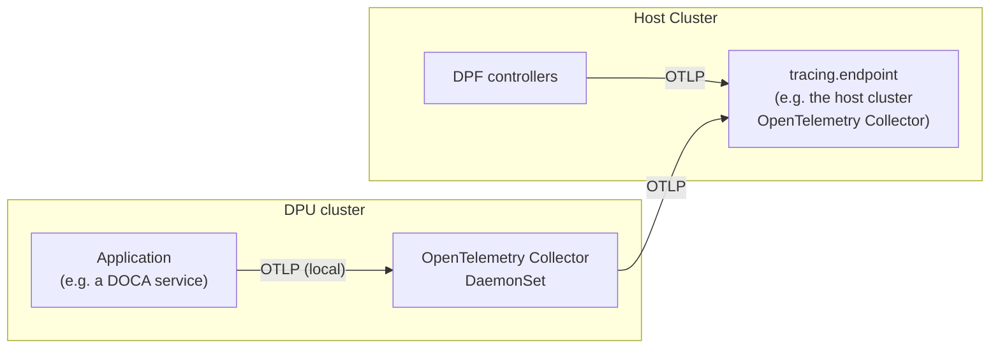

[[_TOC_]]

## Introduction

The components Kube-State-Metrics and Node-Problem-Detector are deployed by default and configured by the DPF operator via the `DPFOperatorConfig.spec.monitoring` field. OpenTelemetry Collector requires additional explicit endpoint configuration.

To disable all DPF-operator-managed monitoring components:

```yaml
apiVersion: operator.dpu.nvidia.com/v1alpha1
kind: DPFOperatorConfig
metadata:
  name: dpfoperatorconfig
  namespace: dpf-operator-system
spec:
  monitoring:
    disable: true
```

## Kube-State-Metrics

`Kube-State-Metrics` (KSM) exposes metrics about Kubernetes object states. This DPF-operator-managed KSM instance monitors DPU cluster resources only.

For Host Cluster Kubernetes resource metrics, a separate KSM instance must be deployed by the user — see [User-Managed Components](user-managed-components.md#kube-state-metrics).

### Deployment Architecture

KSM is deployed with a split architecture:

1. **Host Cluster Deployment**: A single Deployment that connects remotely to each DPU cluster's API server to collect metrics
2. **DPU Cluster RBAC**: RBAC-only resources on each DPU cluster grant permissions for the Host Cluster KSM

### Monitored DPU Resources

KSM collects metrics for the following DPU custom resources:

**IPAM Resources:**

* `IPPool`: IP address pool status and allocation metrics
* `CIDRPool`: CIDR pool status and allocation metrics

**Service Function Chaining:**

* `ServiceChain`: Service chain status and configuration
* `ServiceChainSet`: Service chain set status
* `ServiceInterface`: Service interface status and health
* `ServiceInterfaceSet`: Service interface set status

**Kubernetes Resources:**

* `Pods`, `Deployments`, `DaemonSets`, and more. See [Kube-State-Metrics documentation](https://github.com/kubernetes/kube-state-metrics/tree/main/docs) for a complete list.

### Configuration

KSM is enabled by default. To disable KSM while keeping other monitoring components enabled:

```yaml
apiVersion: operator.dpu.nvidia.com/v1alpha1
kind: DPFOperatorConfig
metadata:
  name: dpfoperatorconfig
  namespace: dpf-operator-system
spec:
  monitoring:
    kubeStateMetrics:
      disable: true
```

To customize KSM image and resources:

<details markdown="1"><summary><b>Expand for KSM Configuration Example</b></summary>

```yaml
spec:
  monitoring:
    kubeStateMetrics:
      daemon:
        image: "registry.k8s.io/kube-state-metrics/kube-state-metrics:v2.18.0"
        resources:
          limits:
            cpu: "200m"
            memory: "512Mi"
          requests:
            cpu: "100m"
            memory: "256Mi"
```

</details>

KSM metrics are automatically scraped by Prometheus via ServiceMonitor.

## Node-Problem-Detector

Node-Problem-Detector (NPD) monitors DPU node health and reports problems as Node conditions. It runs as a DaemonSet on each DPU cluster node. The DaemonSet is unprivileged: checks read the host sysfs, host process metadata and the persistent journal through read-only mounts, and the DPU cluster admission policy rejects privileged node-problem-detector pods.

### Health Checks

NPD includes DPU-specific health checks that run every 30 seconds:

| Condition Type          | Check Description                         |
|-------------------------|-------------------------------------------|
| `OVSvSwitchdHealthy`    | Verifies ovs-vswitchd process is running  |
| `OVSDBHealthy`          | Verifies ovsdb-server process is running  |
| `OVSHealthy`            | Checks for OVS process OOM kills          |
| `PFRepresentorsHealthy` | Verifies host PF representors are present |
| `UplinkHealthy`         | Checks physical uplink is operational     |
| `MTUConfigured`         | Validates network MTU configuration       |

Additionally, NPD monitors standard Kubernetes node problems (kernel deadlocks, read-only filesystems, disk pressure, OOM events). DPU mode (embedded vs separated) is enforced at provisioning time by the DPU agent and is not re-checked by NPD, since querying it requires privileged device access.

### Integration with DPU Status

Node conditions from NPD are aggregated into the DPU resource's `operationalConditions` field via the `NodeProblemsReady` condition, providing centralized visibility into node health.

### Configuration

NPD is enabled by default. To disable NPD while keeping other monitoring components enabled:

```yaml
spec:
  monitoring:
    nodeProblemDetector:
      disable: true
```

To customize NPD:

<details markdown="1"><summary><b>Expand for NPD Configuration Example</b></summary>

```yaml
spec:
  monitoring:
    nodeProblemDetector:
      daemon:
        image: "registry.k8s.io/node-problem-detector/node-problem-detector:v1.35.1"
        resources:
          limits:
            cpu: "200m"
            memory: "256Mi"
          requests:
            cpu: "100m"
            memory: "128Mi"
```

</details>

### Monitoring DPU Health

Node-Problem-Detector health checks are aggregated into the DPU's operational status. To monitor DPU health:

```bash
$ kubectl -n dpf-operator-system get dpu
NAME                   READY   OPERATIONAL   PHASE   AGE
worker1-mt2413xz0b67   True    True          Ready   73d
worker2-mt2413xz0b6w   True    True          Ready   73d
```

Health is reported by the `READY` and `OPERATIONAL` columns; `PHASE` only reports the lifecycle stage. See [DPU Operational Readiness](../guides/operational-readiness.md) for more details on the columns, operational conditions and alerting.

NPD also exposes Prometheus metrics on port 20257.

## OpenTelemetry Collector

OpenTelemetry Collector (OTEL) forwards observability signals from DPU clusters to a user-specified endpoint. It can stream two independent signals, each enabled by its own endpoint:

* **Logs** — collected from DPU cluster pods and forwarded via OTLP.
* **Metrics** — container, pod, and node resource metrics scraped from every DPU node's kubelet and streamed to the management cluster, tagged with the originating DPUCluster name (the `cluster` label). This powers the [DPUService Performance dashboard](../dashboards/README.md#dpuservice-performance).

### Architecture

* **OTEL Collector DaemonSet**: Collects logs and/or metrics from the DPU cluster and forwards them to the configured endpoint(s), tagged with the DPU cluster name
* **OTEL Collector Endpoint**: Receives signals from DPU clusters via OTLP and exports to a backend (for metrics, typically Prometheus via its remote-write receiver)

### Configuration

OTEL Collector is **disabled by default**. It is enabled when at least one of `logging.endpoint`, `metrics.endpoint` or `tracing.endpoint` is set; each signal is streamed only when its corresponding endpoint is configured.

Stream logs to an OTLP endpoint:

```yaml
apiVersion: operator.dpu.nvidia.com/v1alpha1
kind: DPFOperatorConfig
metadata:
  name: dpfoperatorconfig
  namespace: dpf-operator-system
spec:
  monitoring:
    openTelemetryCollector:
      logging:
        endpoint: "http://<host-node-ip>:30050"
```

Stream DPU cluster workload metrics to the management cluster (both signals can be enabled together):

```yaml
apiVersion: operator.dpu.nvidia.com/v1alpha1
kind: DPFOperatorConfig
metadata:
  name: dpfoperatorconfig
  namespace: dpf-operator-system
spec:
  monitoring:
    openTelemetryCollector:
      metrics:
        endpoint: "http://<host-node-ip>:30050"
```

> [!NOTE]
> The endpoint can be any OTLP-compatible receiver (OpenTelemetry Collector, observability gateway, cloud service, etc.). For metrics streaming, the management cluster collector writes the received metrics into Prometheus, so the bundled kube-prometheus-stack values must enable the Prometheus remote-write receiver (`prometheus.prometheusSpec.enableRemoteWriteReceiver: true`). See [Helm Prerequisites](../../../getting-started/helm-prerequisites.md).

If using the OpenTelemetry Collector deployed via Helm values (default configuration), it uses NodePort 30050:

```bash
# Get Host Cluster node IP
kubectl get nodes -o wide

# Use format: http://<NODE_IP>:30050
```

### High Availability

A single node IP as the endpoint is a single point of failure: if that node goes down, no logs are forwarded until it returns. The NodePort is open on every Host Cluster node and Kubernetes forwards to any healthy collector pod, so for production point the endpoint at a stable, highly available address instead:

* a DNS name resolving to one of the below (recommended),
* a failover VIP that floats across the Host Cluster nodes (e.g. kube-vip or keepalived). The address must front the nodes themselves so the NodePort is reachable through it, an external load balancer that only forwards the Kubernetes API port does not qualify, or
* a `LoadBalancer` Service address.

The DPU cluster collectors buffer and retry on failure, so a short address failover does not lose logs.

> **Note**
> A `DPUCluster` with `spec.clusterEndpoint.keepalived` already exposes such a VIP. Keepalived is plain VRRP failover, not a load balancer: one node holds the address at a time, so it gives address failover but no load distribution. That is fine for test and development clusters; for production prefer a `LoadBalancer` or DNS name in front of a replicated receiver, as described below.

The receiving end, the collector the DPU clusters export to, must itself be highly available and preserve end-to-end TLS. A production-ready receiver has three properties:

1. **The collector is replicated.** Run the receiving OpenTelemetry Collector as a `Deployment` with at least two replicas behind the Service. A VIP in front of a single collector pod is still a single point of failure.
2. **The load balancer is L4 (TCP) pass-through.** The DPU clusters verify the receiver's own certificate via `caSecretRef`, so the TLS connection must terminate at the collector, not at the load balancer. An L7 load balancer that terminates TLS with its own certificate breaks verification unless it presents the certificate whose CA is in `caSecretRef`.
3. **The serving certificate covers the dialed address.** The address the DPU clusters dial must appear in the certificate SANs: a DNS SAN for a DNS name, or an IP SAN for a VIP.

The example below fronts a replicated collector with a MetalLB VIP on bare metal and addresses it by DNS name. The VIP mechanism is interchangeable with kube-vip or a cloud `LoadBalancer`; see the [MetalLB](https://metallb.io/) or [kube-vip](https://kube-vip.io/) documentation for the VIP itself.

A cert-manager `Certificate` for the gateway, with the DNS name as a SAN (use `ipAddresses` with the VIP to address it by IP instead):

```yaml
apiVersion: cert-manager.io/v1
kind: Certificate
metadata:
  name: otel-gateway-server-tls
  namespace: monitoring
spec:
  secretName: otel-gateway-server-tls
  issuerRef:
    name: private-ca-issuer
    kind: ClusterIssuer
  dnsNames:
    - otel-gateway.example.com   # resolves to the MetalLB VIP the DPU clusters dial
```

A `LoadBalancer` Service claiming the VIP, in front of the replicated collector:

```yaml
apiVersion: v1
kind: Service
metadata:
  name: otel-gateway
  namespace: monitoring
  annotations:
    metallb.io/loadBalancerIPs: 10.0.0.100
spec:
  type: LoadBalancer
  selector:
    app.kubernetes.io/name: otel-gateway
  ports:
    - name: otlp-http
      port: 4318
      targetPort: 4318
```

Point the DPFOperatorConfig at the DNS name (or the VIP IP) and reference the CA of the private issuer:

```yaml
spec:
  monitoring:
    openTelemetryCollector:
      logging:
        endpoint: "https://otel-gateway.example.com:4318"
        caSecretRef:
          name: otel-gateway-server-tls
          namespace: monitoring
```

`caSecretRef` reads `ca.crt` straight from the cert-manager Secret in the receiver's namespace, so the CA does not need to be copied into `dpf-operator-system`.

### Transport

By default the collector exports data via OTLP/HTTP. Set `transport: grpc` to export via OTLP/gRPC instead:

```yaml
spec:
  monitoring:
    openTelemetryCollector:
      logging:
        endpoint: "otel.example.com:4317"
        transport: grpc
```

For the `http` transport the endpoint must include the scheme (`http://` or `https://`). For the `grpc` transport the endpoint is `host:port` and TLS is used unless the endpoint is prefixed with `http://`.

`transport` is configured per signal. The `metrics` configuration takes the same field, so logs and metrics can use different transports and endpoints.

### TLS and Custom CA Certificates

HTTPS endpoints are verified against the system CA pool by default. If the endpoint serves a certificate issued by a private CA, provide the CA bundle via a Secret referenced by `caSecretRef`. The Secret may live in any namespace, for example alongside the endpoint's cert-manager `Certificate`; if `namespace` is omitted, the `dpf-operator-system` namespace is used. The certificate is never skipped from verification.

```bash
kubectl create secret generic otel-ca \
  --namespace dpf-operator-system \
  --from-file=ca.crt=/path/to/ca.crt
```

```yaml
spec:
  monitoring:
    openTelemetryCollector:
      logging:
        endpoint: "https://otel.example.com:4318"
        caSecretRef:
          name: otel-ca
```

`caSecretRef` is configured per signal as well. Set it on `metrics` to verify the metrics endpoint, referencing the same Secret as `logging` when both signals go to the same receiver:

```yaml
spec:
  monitoring:
    openTelemetryCollector:
      logging:
        endpoint: "https://otel.example.com:4318"
        caSecretRef:
          name: otel-ca
      metrics:
        endpoint: "https://otel.example.com:4318"
        caSecretRef:
          name: otel-ca
```

To reference the CA where cert-manager wrote it, set `namespace` (and `key`, if the bundle is stored under a key other than `ca.crt`):

```yaml
spec:
  monitoring:
    openTelemetryCollector:
      logging:
        endpoint: "https://otel.example.com:4318"
        caSecretRef:
          name: otel-gateway-server-tls
          namespace: monitoring
          key: ca.crt
```

> [!NOTE]
> The Secret must contain the PEM-encoded CA bundle under the `caSecretRef.key` key, defaulting to `ca.crt`. Changes to the Secret content are applied on the next reconciliation of the DPFOperatorConfig. A `caSecretRef` cannot be combined with a plaintext `http://` endpoint.

<details markdown="1"><summary><b>Expand for Advanced OTEL Configuration</b></summary>

```yaml
spec:
  monitoring:
    openTelemetryCollector:
      logging:
        endpoint: "https://otel.example.com:4318"
        transport: http
        caSecretRef:
          name: otel-ca
      metrics:
        endpoint: "otel.example.com:4317"
        transport: grpc
        caSecretRef:
          name: otel-ca
      daemon:
        image: "otel/opentelemetry-collector-contrib:0.146.1"
        resources:
          limits:
            cpu: "500m"
            memory: "1Gi"
          requests:
            cpu: "200m"
            memory: "512Mi"
```

</details>

To extend or replace the default OpenTelemetry Collector configuration with your own,
see [Custom Configuration](user-managed-components.md#custom-configuration).

## Tracing

DPF controllers can export distributed trace spans for their reconcile loops via OpenTelemetry, using the `tracing.k8s.io/traceparent` and `tracing.k8s.io/tracestate` annotations an upstream caller (e.g. carbide) sets on the CRs it creates, so a single request can be followed across DPF's own controllers. See [Setting the trace context](#setting-the-trace-context) for the objects a caller sets them on.

`tracing.endpoint` is a single destination shared by two independent producers:

* **DPF's own controller binaries** (Host Cluster) export spans for their own reconcile loops directly to `tracing.endpoint`, using their own embedded OpenTelemetry SDK — there is no DaemonSet in this path.
* **The DPU cluster's OpenTelemetry Collector DaemonSet** also accepts trace spans pushed to it locally over OTLP (port 4317/4318, the same receiver already used for OTLP-native logs and metrics) from any other process running on the DPU — for example another DOCA service — and forwards them on to the same `tracing.endpoint`. No second collector is required in front of it; the DaemonSet's `otlp` receiver already accepts arbitrary local OTLP traffic today for logs/metrics, and traces follow the identical path:



For how a DPF controller is instrumented, see [Tracing](../../../developer-guides/system/tracing.md) in the developer guide.

### Setting the trace context

Set the annotations to the [W3C trace context](https://www.w3.org/TR/trace-context/) of the
request, in the same write as the change it traces. `tracestate` is optional. DPF writes
`tracing.k8s.io/generated-traceparent` and `tracing.k8s.io/generated-tracestate` on the objects it
creates or changes, and a controller reads the pair a caller set first. A trace context left on
an object after its change is done is therefore joined by every later change of the object. Set
a new value with each change, or remove it. DPF removes it only where it ends the trace itself,
see the table below.

DPF reads a trace context from these objects for DPU provisioning:

| Object | Set it when | What continues the trace |
|---|---|---|
| DPUDeployment | creating it or changing its spec | The DPUDeployment reconciles, the DPUSets it creates or updates, and the DPUs they recreate or update in place for that change |
| DPUDevice | creating it, recreating it, or changing its spec | The DPUDevice reconciles, its hostless DPUNode, the DPU the DPUSet creates for it, and the DPUNodeMaintenance and Node changes of that DPU |
| DPUCluster | changing its labels | The DPUs the DPUSet deletes and recreates because the DPUCluster no longer matches their cluster selector |
| DPUFlavorTemplate | changing its template | The DPUs the DPUSet recreates for that change |
| DPUDiscovery | changing its spec | The scan of that change and the DPUDevices and DPUNodes it creates. DPF removes the trace context once the scan has completed, so a periodic scan does not join it |
| DPU | changing it | The DPU reconciles, and its DPUNodeMaintenance and Node changes |

A DPUDeployment or DPUDevice without a trace context still gets one trace per change: DPF
derives the trace from its UID and generation and exports a `dpudeploymentcontroller.rollout` or
`dpudevice.rollout` root span that ends when the DPUDeployment, or the DPU of the DPUDevice, is
Ready. For a DPUDeployment, a change of
a BFB, BlueFieldSoftware, DPUFlavor or DPUFlavorTemplate it references also
starts a new trace, including when one of them is deleted and recreated under
the same name. A recreated DPUDevice has a new
UID and starts a new trace. Any other object without a trace context is not continued: its
changes do not move the DPUs onto a trace of their own.

When the DPUSet replaces a DPU, it copies the trace of the cause onto the DPUDevice before it
deletes the DPU, so the DPU it recreates continues the cause. This removes a trace context a
caller set on the DPUDevice. When the cause has no trace context, the DPUSet removes the
DPUDevice's trace context instead, so the recreated DPU continues the DPUDevice's own trace
rather than an earlier change's. The DPUSet copies the same trace onto the DPU it deletes, so
its cleanup, such as the `dpu.phase.Deleting` span, appears in the same trace as its
replacement. A DPU that was already being deleted keeps its trace. The cause is the DPUSet, and so its DPUDeployment, unless the
change came only from a DPUFlavorTemplate, a DPUCluster or the DPUDevice values, as listed above.

### Configuration

Tracing is disabled by default. Set `tracing.endpoint` to enable it; this both makes DPF controllers export their own spans and, if the opentelemetry-collector component is otherwise disabled, deploys the DPU cluster collector so it can accept and forward traces from other local emitters:

```yaml
apiVersion: operator.dpu.nvidia.com/v1alpha1
kind: DPFOperatorConfig
metadata:
  name: dpfoperatorconfig
  namespace: dpf-operator-system
spec:
  monitoring:
    openTelemetryCollector:
      tracing:
        endpoint: "http://<host-node-ip>:30050"
```

`tracing` takes the same `transport` and `caSecretRef` fields as `logging`/`metrics` — see [Transport](#transport)
and [TLS and Custom CA Certificates](#tls-and-custom-ca-certificates) above. A separate collector deployed as its own
DPUService forwards only the pipelines in its own `config`.
See [Custom Configuration](user-managed-components.md#custom-configuration).
Disable the packaged collector with `spec.monitoring.openTelemetryCollector.disable: true` when the packaged trace
forwarding should stop.

### Viewing traces

DPF only exports the spans. The reference monitoring stack deploys [Tempo](https://grafana.com/docs/tempo/latest/) as the trace backend and wires it into Grafana as a datasource named **Tempo**, alongside the **Loki** and **Prometheus** datasources. From Grafana:

* **Explore → Tempo**, search by any span attribute (`controller`, `k8s.resource.kind`, `k8s.namespace.name`, `k8s.object.name`, ...) to find a trace.
* Search `{ name = "dpudeploymentcontroller.change" }` to find the changes of DPUDeployments, and open one to see what ran for it. The trace has the reconciles of all controllers that ran for that change. Reconciles that find nothing changed are not recorded.
* A reconcile span has `reconcile.changes`, what the reconcile changed on its own object: `none`, `status`, `spec` (the generation moved), `metadata` (labels, annotations or finalizers), or several joined with `+`. Controllers keep rewriting their status while children settle, so `{ span.reconcile.changes != "status" && span.reconcile.changes != "none" }` hides those reconciles.
* A DPUDeployment and a DPUService also export one rollout span per generation, `dpudeploymentcontroller.rollout` and `dpuservice-manager.rollout`. It lasts from the change until it is ready and marks the end of the change, and it is the root with the real duration. While the change is in progress, an instant `dpudeploymentcontroller.change` span is the root of the trace. `rollout.result` is `ready`, `timeout` (not ready after an hour) or `superseded` (a newer generation came first). Search `{ name = "dpudeploymentcontroller.rollout" }` to see how long changes took.
* A DPUService reconcile has child spans for its slow steps: `dpuservice.argocd-application` (with `application.action` create, update or unchanged), `dpuservice.image-pull-secrets`, and for a DPUServiceCredentialRequest `credentialrequest.service-account` and `credentialrequest.secret`.
* The DPUServiceChain, DPUServiceInterface, DPUServiceIPAM and DPUServiceNAD reconciles have a child span for each call to a DPU cluster: `dpucluster.apply`, `dpucluster.readiness` (with `objects.count` and `objects.unready`) and `dpucluster.delete`, all with `dpucluster.name`.
* A Node reconcile of the node SR-IOV device plugin controller has a `nodesriovdeviceplugin.sync-pod` child span, with `pod.action` create, delete, recreate or none, so a reconcile that only looked at the node is still visible.
* A span also carries the kind and name of the controller owner of its object (`k8s.owner.kind`, `k8s.owner.name`). Search by them to find the reconciles of everything one owner created, for example `{ span.k8s.owner.kind = "DPUDeployment" && span.k8s.owner.name = "<dpudeployment>" }` for the objects a DPUDeployment created. Follow the chain by using the names that come back as the owner in the next query.
* From a log line in Loki that contains a `traceID=` field, the **TraceID** derived field jumps straight to the matching trace in Tempo.
* From a span in Tempo, **trace to logs** jumps to the matching Loki entries and **trace to metrics** jumps to that span's service in Prometheus.
